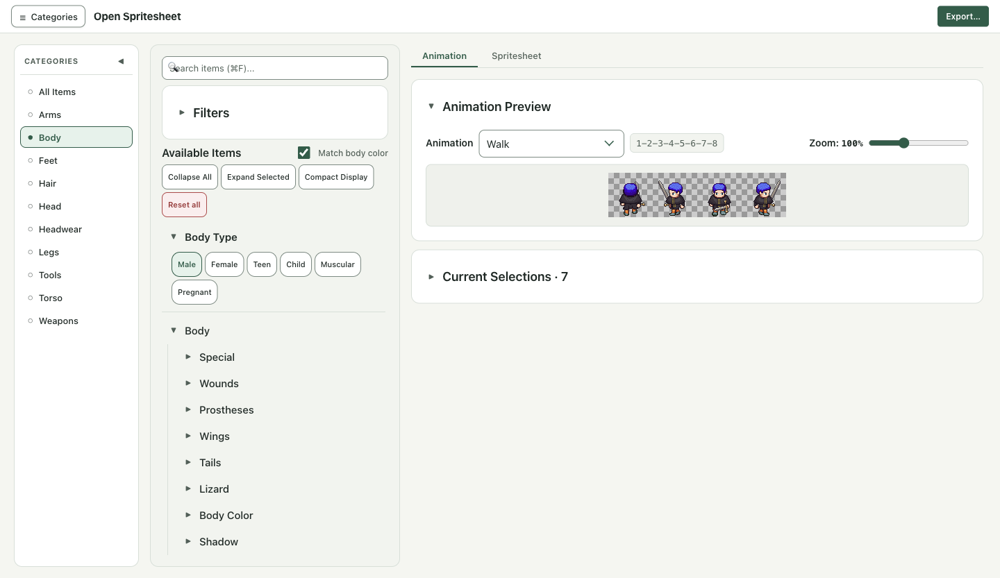

# Open Spritesheet

Open Spritesheet là ứng dụng macOS chạy ngoại tuyến để tạo spritesheet nhân vật pixel theo bộ tài nguyên Liberated Pixel Cup (LPC). Bạn có thể tạo nhân vật, xem hoạt ảnh và xuất tệp ngay trên máy.

## Tính năng

- Ghép các lớp nhân vật như cơ thể, tóc, trang phục và vũ khí. Chọn biến thể và bảng màu cho từng lớp.
- Xem trước hoạt ảnh và spritesheet đầy đủ.
- Xuất spritesheet dạng PNG hoặc đóng gói ZIP theo hoạt ảnh, thành phần hoặc từng khung hình.
- Sao chép và nhập JSON để lưu hoặc khôi phục cấu hình nhân vật. Tải danh sách ghi công dưới dạng TXT hoặc CSV.

## Cài đặt trên macOS

Yêu cầu Mac dùng chip Apple Silicon và macOS 13 trở lên.

1. Tải tệp `OpenSpritesheet-*-mac-arm64.dmg` từ [bản phát hành mới nhất](https://github.com/teakay1311/OpenSpritesheet/releases/latest).
2. Mở DMG và kéo **Open Spritesheet** vào **Applications**.
3. Mở **Open Spritesheet** từ **Applications**.

Bản cài dùng chữ ký ad-hoc và chưa được Apple notarize. Tệp `.sha256` đi kèm dùng để kiểm tra tính toàn vẹn của DMG.

## Giấy phép và ghi công

- Mã ứng dụng dùng [GPL-3.0](LICENSE). Mã đóng gói macOS dùng [Apache-2.0](macos/LICENSE).
- Mỗi tài nguyên hình ảnh có giấy phép riêng. [CREDITS.csv](CREDITS.csv) ghi tác giả, giấy phép và nguồn của từng tài nguyên. Khi dùng spritesheet trong dự án của bạn, hãy ghi công theo giấy phép áp dụng. [Hướng dẫn ghi công chi tiết](https://github.com/LiberatedPixelCup/Universal-LPC-Spritesheet-Character-Generator/blob/86a3719ee4a7e2e9fb27c7c152e29a741d3e930a/README.md#licensing-and-attribution-credits)

## Dự án gốc

Open Spritesheet phát triển từ [Universal LPC Spritesheet Character Generator](https://github.com/LiberatedPixelCup/Universal-LPC-Spritesheet-Character-Generator). [Lịch sử dự án LPC](https://github.com/LiberatedPixelCup/Universal-LPC-Spritesheet-Character-Generator/blob/86a3719ee4a7e2e9fb27c7c152e29a741d3e930a/README.md#history)
